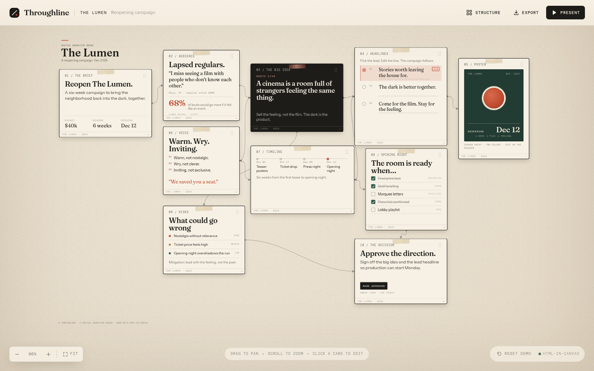
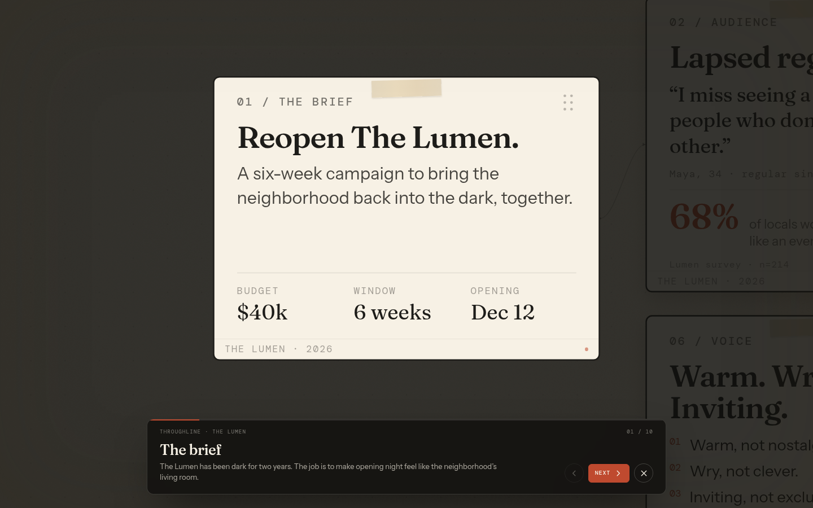
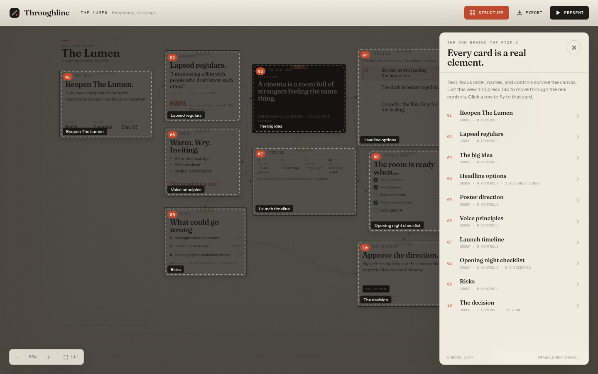
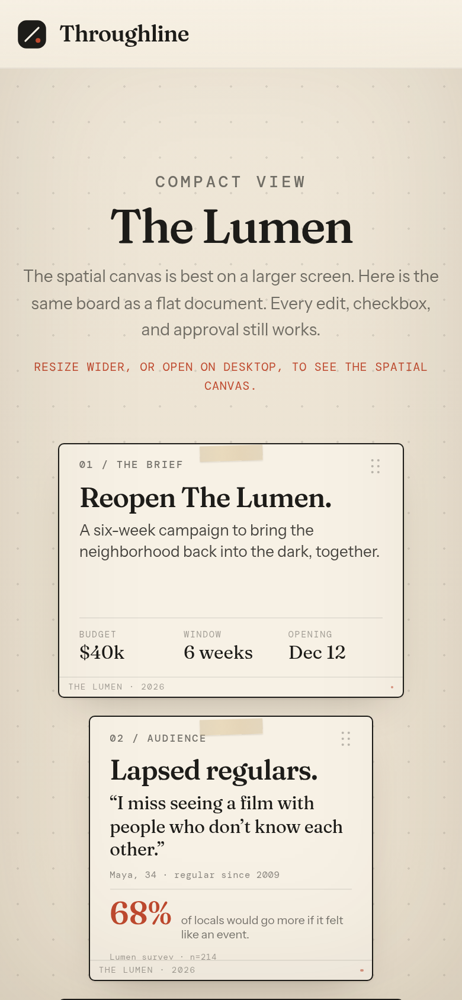

# Throughline

A spatial narrative board for shaping a launch story. Built with HTML-in-Canvas, React, TypeScript, and Vite.



Throughline demonstrates the HTML-in-Canvas API in Chrome 157+. Every card on the board is real DOM: real text, real inputs, real checkboxes, real focus order, real screen reader names. The browser paints those cards into a 2D canvas with `drawElementImage()`, so they can be moved, zoomed, and presented like canvas objects without giving up the behavior of HTML.

## The demo

The board tells the story of a fictional neighborhood cinema reopening campaign, The Lumen. It is not a screenshot. Try:

- Click a card to select it. Drag the card header to move it.
- Click into a headline and rewrite it. The canvas updates as you type.
- Check an opening night task.
- Approve the direction and watch the stamp appear.
- Press Present, then use the arrow keys. The camera flies to each card.
- Open Structure to see the real DOM behind the pixels, including tab order and control counts.
- Export a PNG of the board.
- Pan with the background, scroll to zoom, and press Fit to return.

Edits and card positions save to localStorage. Reset demo restores the original board.

### Presentation mode



### Structure view



### Compact and fallback views



On screens at or below 760px wide or 520px tall, the demo renders the same cards as a flat document. On browsers without HTML-in-Canvas, the flat view is also the fallback, with a note about Chrome 157+.

## Run it

```bash
npm install
npm run dev
```

Open the local URL in Chrome 157 or later. The API is on by default in Chrome 157+.

For Chromium 147 to 156, Brave, or older Chrome builds, enable `chrome://flags/#canvas-draw-element`, relaunch, and open the demo. The canvas sets both the current `content="drawable"` and the older `layoutsubtree` attributes.

Build:

```bash
npm run build
npm run preview
```

## How it works

The API setup is small:

```html
<canvas content="drawable" layoutsubtree>
  <article drawable>...</article>
  <article drawable>...</article>
</canvas>
```

- The canvas's direct children are the cards.
- `content="drawable"` opts the children into layout and hit testing. Older Chromium builds use `layoutsubtree`, so the demo sets both.
- `drawable` marks each card as an independent paint root.
- The canvas listens for the `paint` event and redraws.
- `ctx.drawElementImage(card, x, y, width, height)` paints the live card into the canvas.
- In 2D, the browser keeps hit testing and accessibility geometry in sync with the drawn position. Manual transform piping is not needed in Chrome 155+.

The renderer lives in `src/board/renderer.ts`. The board state and interactions are in `src/board/BoardCanvas.tsx`.

### The card strategy

The cards are positioned at the canvas origin in the DOM and sized at the current render scale. The canvas draws them at their screen positions. This keeps the DOM layout and the canvas snapshots in sync while allowing the camera to move independently.

On zoom, the render scale is updated after a short debounce, so the card is laid out at the new size and drawn at 1:1. During the gesture, the existing snapshot is scaled. When the zoom settles, the card is crisp again. During presentation, the cards are laid out at a viewport-aware scale (up to 3.2x) before the camera animation, so the snapshot is downscaled while the camera flies, not upscaled.

Every card uses `em` units internally, so scaling the card's font size scales the whole design proportionally. The board uses a warm paper palette, Fraunces for display type, Instrument Sans for body copy, and DM Mono for labels.

### Accessibility

The cards are not painted pixels pretending to be UI. They are the UI.

- Each card is a `role="group"` with an accessible name.
- Inner headings, radios, textareas, checkboxes, and buttons keep their native semantics.
- Focus order follows the narrative order.
- Present mode marks non-focused cards `inert`, so a screen reader and keyboard only see the card being presented.
- The Structure view lists the real elements and their control counts.
- The focused element's caret, selection, and focus ring are drawn into the canvas by the browser.

The Structure view is a semantic map, not a live accessibility tree inspector. The cards themselves are the live accessibility tree.

### Performance

The demo renders 10 cards and only redraws when the canvas `paint` event fires, when the camera moves, or when the selection or mode changes. Static cards are not re-laid out on pan. The grain texture is generated once and reused as a canvas pattern.

At 100 or more cards, the next steps would be:

- Cull cards outside the viewport.
- Cache static cards in an offscreen canvas.
- Use a level-of-detail scale per card instead of re-laying out on every zoom settle.
- Move export rendering to a worker with `captureElementImage()` and `OffscreenCanvas`.
- Virtualize the DOM layer so offscreen cards are removed or marked `inert`.

### Export

Export waits for the next `paint` event after clearing the selection and structure overlay, then calls `canvas.toBlob()`. The PNG is captured at the canvas's current device pixel resolution.

### Limitations

- HTML-in-Canvas is Chrome 157+ today. Safari and Firefox do not ship it yet.
- The demo is a 2D board. WebGL and WebGPU can use the same API, but need explicit geometry updates for hit testing.
- CSS transforms on a drawable element are ignored for drawing. The board moves the camera and the draw positions, not the cards' CSS transforms.
- The Structure view is a semantic map, not a full accessibility tree inspector.
- The exported PNG is the current board view, not a separate print layout.

## Project structure

```
src/
  App.tsx                 app shell, modes, keyboard, persistence, export
  board/
    BoardCanvas.tsx       canvas, camera, paint loop, pointer interactions
    Card.tsx              the real HTML cards
    renderer.ts           background, connectors, cards, present and structure views
    camera.ts             fit, present, zoom, and animation math
    data.ts               The Lumen content and board layout
    storage.ts            localStorage persistence
    types.ts              shared types
  index.css               design tokens and base styles
  App.css                 app chrome, present HUD, structure panel, flat view
  board/board.css         card typography and content styles
docs/                     screenshots used by this README
```

## Built with

- HTML-in-Canvas, Chrome 157+
- React 19, TypeScript, Vite
- Fraunces, Instrument Sans, and DM Mono via Fontsource

## What I would do next

- A real case study route with a 60-second walkthrough and performance numbers.
- A "new card" flow and a small card type system.
- A worker-based export at 2x or 4x.
- A comparison page against `html2canvas` for text quality, accessibility, and speed.
- A WebGL version of the same board for depth, blur, and page transitions.

## License

No license has been added. Add one before distributing the code.
